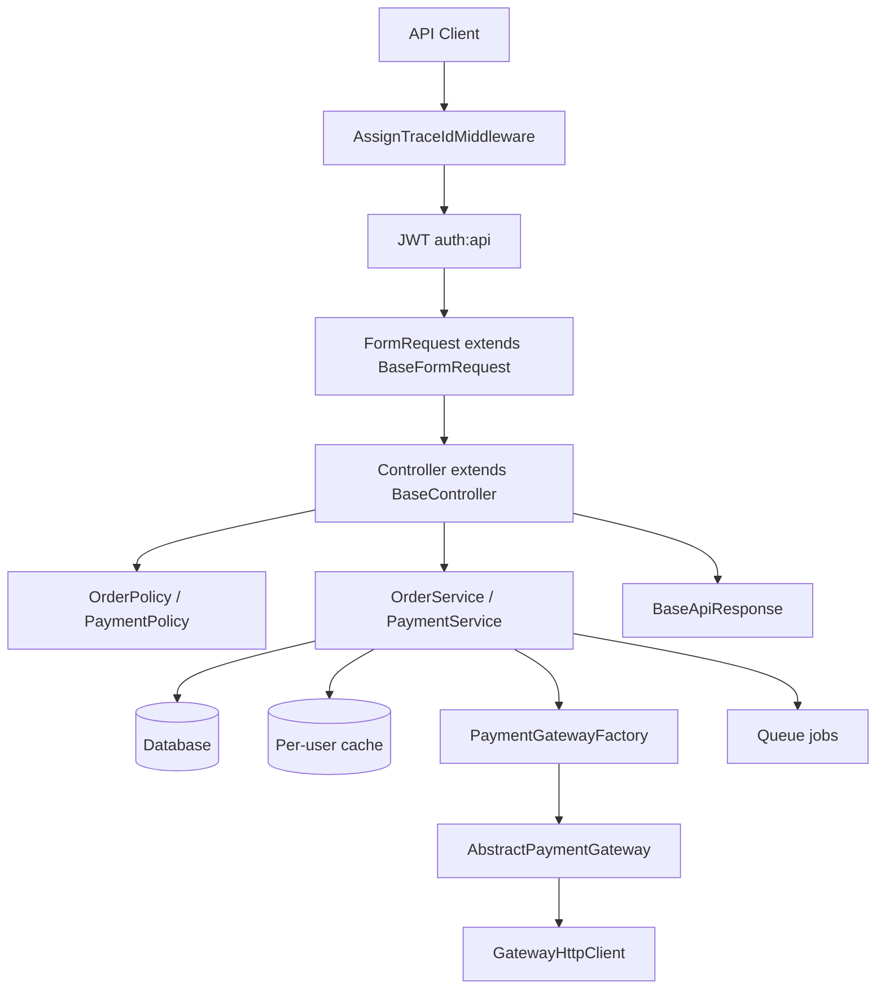

# Extendable Order and Payment API

Laravel 12 API for orders and payments. New payment gateways are added by registering a strategy class. The HTTP surface, order rules, and payment service stay unchanged.

## Architecture



A new gateway is one class, one `config/payment.php` entry, and its environment keys. `PaymentGatewayFactory` resolves it. `AbstractPaymentGateway::process()` owns the shared flow, and `GatewayHttpClient` owns the outbound call, including a cached OAuth client-credentials token.

## Requirements

- PHP 8.3 or newer, with the `bcmath` and `pdo` extensions
- Composer 2
- MySQL 8 and Redis 7 for the full stack
- Docker, if you use the compose file below

Tests do not need MySQL or Redis. They use SQLite in memory, the array cache, and the sync queue.

## Setup with Docker

No local PHP is needed. Generate the keys inside the image:

```bash
cp .env.example .env
docker compose build
docker compose run --rm --no-deps app php artisan key:generate
docker compose run --rm --no-deps app php artisan jwt:secret --force
```

Set `DOCS_USERNAME` and `DOCS_PASSWORD` in `.env`. The developer tools stay locked while either value is empty. Compose sets `DB_HOST=mysql` and `REDIS_HOST=redis` for the containers, waits for both services to be healthy, and runs the migrations.

```bash
docker compose up
```

The API is served at `http://localhost:8000`. Horizon runs in the `horizon` service.

## Setup without Docker

```bash
composer install
cp .env.example .env
php artisan key:generate
php artisan jwt:secret
```

Create the MySQL database from `.env.example`, start Redis, then:

```bash
php artisan migrate
php artisan serve
php artisan horizon
```

`REDIS_CLIENT` is `predis`, so the Redis PHP extension is optional.

SQLite also works for a local look at the API. Set `DB_CONNECTION=sqlite`, `CACHE_STORE=database`, and `QUEUE_CONNECTION=database`, then run `php artisan migrate`.

## Authentication

All order and payment routes expect `Authorization: Bearer <token>`.

| Method | Path | Purpose |
| --- | --- | --- |
| POST | `/api/v1/auth/register` | Create an account and return a JWT |
| POST | `/api/v1/auth/login` | Login. Limited to 5 attempts per minute |
| GET | `/api/v1/auth/me` | Current user |
| POST | `/api/v1/auth/refresh` | Rotate the JWT. Accepts an expired token inside `JWT_REFRESH_TTL` |
| POST | `/api/v1/auth/logout` | Invalidate the JWT |

## Orders and payments

| Method | Path | Rule |
| --- | --- | --- |
| GET | `/api/v1/orders` | The caller's orders. Filter with `status`. Use `pagination=cursor` for large lists. Item lines are on the show endpoint |
| POST | `/api/v1/orders` | Create a pending order. The server calculates `total` |
| GET | `/api/v1/orders/{order}` | One owned order |
| PUT/PATCH | `/api/v1/orders/{order}` | Update details, items, or status |
| DELETE | `/api/v1/orders/{order}` | Allowed only when the order has no payments |
| GET | `/api/v1/payment-methods` | Enabled gateways from configuration |
| POST | `/api/v1/orders/{order}/payments` | Charge a confirmed order |
| GET | `/api/v1/orders/{order}/payments` | Payments for one order |
| GET | `/api/v1/payments` | The caller's payments. Filter with `status` and `method` |
| GET | `/api/v1/payments/{payment}` | One owned payment |

Status moves from `pending` to `confirmed` or `cancelled`. A confirmed order can move to `cancelled` only when it has no successful payment. `cancelled` is final. Item changes are allowed only while the order is `pending`.

A charge locks the order row, stores the payment, and calls the selected gateway. A declined charge is stored as `failed` and still blocks deletion. Send `Idempotency-Key` to replay the same charge safely. The same key with a different order, method, amount, or `simulate_outcome` returns `PAY-PRC-006`.

`.env.example` sets `CREDIT_CARD_SIMULATE=true` and `PAYPAL_SIMULATE=true`, so no external call is made. Send `"simulate_outcome": "failed"` to store a declined payment. When the variable is missing, simulation is off and the gateway requires its keys, so a production deploy never accepts payments without charging. Idempotency keys are scoped to the user and limited to 255 letters, digits, `.`, `_`, `:`, and `-`. When the client sends none, the gateway still receives a server-generated key.

A disabled or misconfigured gateway returns `PAY-PRC-003` and stores nothing. Only a real decline or gateway failure is stored as a `failed` payment.

## Response envelope

Every JSON response uses the same shape. Response classes extend `Modules\Core\Http\Responses\BaseApiResponse`.

```json
{
  "success": true,
  "trace_code": "ORD-CRT-200",
  "code": "201",
  "message": "Order created successfully.",
  "trace_id": "0b6c1c2e-1d4a-4f0e-9c2a-6b1e0a9d4f11",
  "data": {},
  "meta": null
}
```

`code` is the HTTP status as a string, so a mobile or frontend client can branch on `200`, `401`, `409`, `422`, and the other statuses it already knows. `trace_code` identifies the module and action. When a request fails, the client shows `trace_code` to the user so they can report it. `PAY-PRC-004` is a declined payment. `ORD-DEL-001` is a delete blocked by an existing payment. Validation errors also include `errors`.

Unexpected exceptions return `SYS-GEN-001` and a `trace_id`. The exception message, stack trace, error code, user id, and masked input are written once to `storage/logs/laravel-YYYY-MM-DD.log`. Business errors such as `AUTH-LGN-002` are logged as warnings without a stack trace. Gateway traffic is written to `storage/logs/payments-YYYY-MM-DD.log`. Card numbers keep only the last four digits, and passwords, tokens, keys, and secrets are replaced with `[REDACTED]`. Every log line and the `X-Trace-Id` response header carry the same `trace_id`. A client can send its own `X-Trace-Id` of 8 to 64 letters, digits, and dashes; anything else is replaced.

API routes always answer in JSON, even when the client does not send `Accept: application/json`.

## Error code index

| Code | HTTP | Meaning |
| --- | --- | --- |
| SYS-GEN-001 | 500 | Unexpected error. Details are in the log for this trace id |
| SYS-GEN-002 | 404 | Route or resource was not found |
| SYS-GEN-003 | 405 | Method not allowed |
| SYS-GEN-004 | 429 | Rate limit exceeded |
| SYS-GEN-005 | 403 | The resource belongs to another user |
| SYS-GEN-006 | 4xx | Other HTTP error. The status matches the error, for example 400 or 413 |
| SYS-VAL-001 | 422 | Validation failed outside an endpoint-specific form request |
| AUTH-REG-001 | 422 | Registration validation failed |
| AUTH-LGN-001 | 422 | Login validation failed |
| AUTH-LGN-002 | 401 | Email or password is wrong |
| AUTH-TKN-001 | 401 | Missing or invalid token |
| AUTH-TKN-002 | 401 | Token expired |
| ORD-LST-001 | 422 | Order list filters are invalid |
| ORD-SHW-001 | 404 | Order was not found |
| ORD-CRT-001 | 422 | Create order validation failed |
| ORD-UPD-001 | 422 | Update order validation failed |
| ORD-UPD-002 | 409 | Items can change only while the order is pending |
| ORD-UPD-003 | 409 | Status transition is not allowed |
| ORD-DEL-001 | 409 | Order has payments and cannot be deleted |
| PAY-LST-001 | 422 | Payment list filters are invalid |
| PAY-SHW-001 | 404 | Payment was not found |
| PAY-PRC-001 | 422 | Payment validation failed |
| PAY-PRC-002 | 409 | Only confirmed orders can be paid |
| PAY-PRC-003 | 422 | Gateway is unknown, disabled, or misconfigured |
| PAY-PRC-004 | 402 | Gateway declined the charge. The failed payment is in `data` |
| PAY-PRC-005 | 409 | Order already has a successful payment |
| PAY-PRC-006 | 409 | Idempotency key was reused with a different payload |
| PAY-CFG-001 | — | Logged when a live gateway is missing keys. The client receives `PAY-PRC-003` |

## Developer tools

These pages ask for the username and password in `DOCS_USERNAME` and `DOCS_PASSWORD`:

- `http://localhost:8000/docs` — interactive OpenAPI reference generated from the routes and form requests
- `http://localhost:8000/docs/openapi.json` — OpenAPI 3.1 document
- `http://localhost:8000/docs/error-codes` — searchable error code index
- `http://localhost:8000/log-viewer` — application and payment logs
- `http://localhost:8000/horizon` — Redis queues

The Postman collection is `postman/Order_Payment_API.postman_collection.json`. Import `postman/Order_Payment_API.postman_environment.json` for the local base URL.

## Adding a payment gateway

1. Create a class that extends `Modules\Payment\Gateways\AbstractPaymentGateway`.
2. Implement `identifier()`, `requiredConfigKeys()`, and `executeCharge()`. Use the injected `GatewayHttpClient` for the outbound call. It sets the method, endpoint, headers, body, and idempotency key, retries connection failures for `GET` only, caches an OAuth client-credentials token, and masks secrets in the payment log.
3. Add one entry under `gateways` in `config/payment.php`, plus the matching `.env` keys.

`ProcessPaymentRequest` allows any key present in that config. No controller, service, or enum change is required.

`AbstractPaymentGateway::process()` is final. It checks that the gateway is enabled, checks live credentials, validates the payload, builds the charge, executes it, and maps the response. A subclass does not repeat that flow.

## Layout

`nwidart/laravel-modules` splits the code into four modules:

- `Modules/Core` — base model, controller, form request, and response; error codes; trace id; exception rendering
- `Modules/Auth` — JWT register, login, profile, refresh, and logout
- `Modules/Order` — orders, totals, status transitions, policies, and per-user list cache
- `Modules/Payment` — gateway contract, factory, HTTP client, credit card, PayPal, and queued notification and audit jobs

List responses are paginated, with cursor pagination for large lists, and the order list leaves item lines to the show endpoint. Pages are cached per user for 60 seconds, with Redis tags when the store supports them and a version key otherwise. Observers clear a user's cache after the database commit, and `WarmOrderListCacheJob` rebuilds the first page on the queue. `Model::preventLazyLoading()` is on outside production, so an N+1 query fails during development and tests.

## Tests

```bash
php artisan test
```

## Assumptions

- A user can only read and change their own orders and payments.
- Order totals use `decimal(12,2)`. A client-supplied `total` is ignored.
- Prices are limited to 99,999.99, quantities to 1,000, and orders to 100 items, so a total always fits the column.
- Payment capture is synchronous and runs while the order row is locked. This is safe for the simulated gateways. With a slow live gateway, the next step would be to commit the pending payment, charge outside the lock, and treat a timeout as pending for reconciliation.
- Notification and audit logging are queued on Redis after the database commit.
- Gateway credentials live in `.env` and are read through `config/payment.php`.
- `.env.example` enables simulation so the project runs without live merchant accounts.
